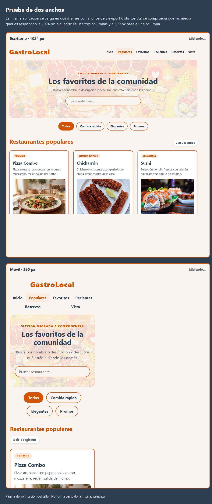

# GastroLocal · React

Aplicación web de restaurantes desarrollada como **taller de componentes** y migrada a **React + Vite**. Incluye búsqueda, filtro por categorías, estado vacío y una tarjeta reutilizable que recibe sus datos mediante `props`.


---

## Contenido del repositorio

| Ruta | Descripción |
|---|---|
| `Clase_C3_02_Guia_Componentes_Props/tallerClase/` | Aplicación **React + Vite** (versión actual). |
| `Clase_C3_02_Guia_Componentes_Props/tallerClase/public/segundo-corte/` | Versión anterior del proyecto en **HTML + CSS + JavaScript**, conservada para comparar. |
| `Clase_C3_02_Guia_Componentes_Props/Clase_C3_02_Guia_Componentes_Props.md` | Guía de la clase. |
| `Plantilla_Bitacora.md` | Bitácora del proceso. |

> La app React vive dentro de `tallerClase/`. Todos los comandos de npm se ejecutan desde esa carpeta.

---

## Tecnologías

| Herramienta | Versión |
|---|---|
| Node.js | 26.13.0 |
| npm | 11.20.0 |
| React | 19.3.1 |
| Vite | 8.3.5 |
| Supabase | Auth + Data API (versión del segundo corte) |

---

## Cómo ejecutar

```bash
# 1. Clonar el repositorio
git clone https://github.com/JuanDavidValencia/gastrolocal-react.git

# 2. Entrar a la app React
cd gastrolocal-react/Clase_C3_02_Guia_Componentes_Props/tallerClase

# 3. Instalar dependencias
npm install

# 4. Levantar el servidor de desarrollo
npm run dev
```

Abre la URL que imprime Vite (por defecto `http://localhost:5173/`).

### Scripts disponibles

```bash
npm run dev       # Servidor de desarrollo con recarga en caliente
npm run build     # Compila la versión de producción en dist/
npm run preview   # Sirve la compilación de producción
```

### Versión del segundo corte

Vite sirve `public/` como contenido estático, así que la versión anterior queda accesible en:

- `http://localhost:5173/segundo-corte/index.html`
- `http://localhost:5173/segundo-corte/populares.html`

---

## Funcionalidades

- **Buscador controlado** por estado (`useState`) que ignora mayúsculas y tildes.
- **Filtro por categorías** con indicador `aria-pressed`.
- **Filtrado combinado** de búsqueda + categoría con `useMemo`.
- **Contador de resultados** (`X de Y registros`) con `aria-live`.
- **Estado vacío** cuando ningún restaurante coincide.
- **Aviso de pedido** al agregar un restaurante (demostración).
- **Diseño responsive**: 3 columnas en escritorio, 1 columna en móvil, sin desborde horizontal.
- **Accesibilidad**: enlace "Saltar a los restaurantes", etiquetas ARIA y foco visible.

---

## Componentes

| Componente | Función | Props |
|---|---|---|
| `Header` | Marca y navegación principal. | — |
| `BannerBuscador` | Título y buscador controlado; solo notifica el texto. | `valor`, `onCambio` |
| `FiltroCategorias` | Selección de categoría con `aria-pressed`. | `categorias`, `categoriaActiva`, `onSeleccionar` |
| `ListaRestaurantes` | Recorre la colección con `.map()`, asigna `key` y resuelve el estado vacío. | `restaurantes`, `onOrdenar` |
| `TarjetaRestaurante` | Presenta categoría, nombre, descripción, imagen, precio y reseña. | `restaurante`, `onOrdenar` |

La misma tarjeta se reutiliza con **tres registros** (`Pizza Combo`, `Chicharrón` y `Sushi`) que llegan por props desde `src/data/restaurantes.js`.

---

## Estructura del proyecto React

```text
tallerClase/
├── index.html
├── package.json
├── vite.config.js
├── public/
│   ├── imagen-respaldo.svg
│   ├── prueba-anchos.html          # Comparación en dos viewports
│   └── segundo-corte/              # Versión HTML/CSS/JS anterior
├── src/
│   ├── main.jsx
│   ├── App.jsx                     # Estado, filtrado y composición
│   ├── components/
│   │   ├── Header.jsx
│   │   ├── BannerBuscador.jsx
│   │   ├── FiltroCategorias.jsx
│   │   ├── ListaRestaurantes.jsx
│   │   └── TarjetaRestaurante.jsx
│   ├── data/
│   │   └── restaurantes.js
│   └── styles/
│       └── styles.css
└── evidencias/
    └── prueba-dos-anchos.png
```

---

## Configuración de Supabase

La versión del segundo corte usa Supabase para autenticación y datos. La configuración está en:

```text
tallerClase/public/segundo-corte/js/config.js
```

```js
export const SUPABASE_URL = "https://<tu-proyecto>.supabase.co";
export const SUPABASE_PUBLISHABLE_KEY = "sb_publishable_...";
export const REDIRECT_URL = "";
```

> La **publishable key** está diseñada para ser pública. Aun así, asegúrate de tener **RLS (Row Level Security)** activado en todas las tablas de Supabase.

---

## Evidencia responsive

La página `prueba-anchos.html` carga la app en dos iframes con viewports distintos y muestra las medidas obtenidas.

| Ancho | Columnas | Ancho de tarjeta | Desborde horizontal |
|---:|---:|---:|---|
| 1024 px | 3 | 310 px | No |
| 390 px | 1 | 343 px | No |



---

## Notas

- `node_modules/` y `dist/` **no** se incluyen en el repositorio (están en `.gitignore`). Se regeneran con `npm install` y `npm run build`.
- El proyecto no usa frameworks de CSS: los estilos son CSS plano con variables.

---

## Autor

**Juan David Valencia Ospina**
- GitHub: [@JuanDavidValencia](https://github.com/JuanDavidValencia)
- Correo: juan.valencia.0677@eam.edu.co
